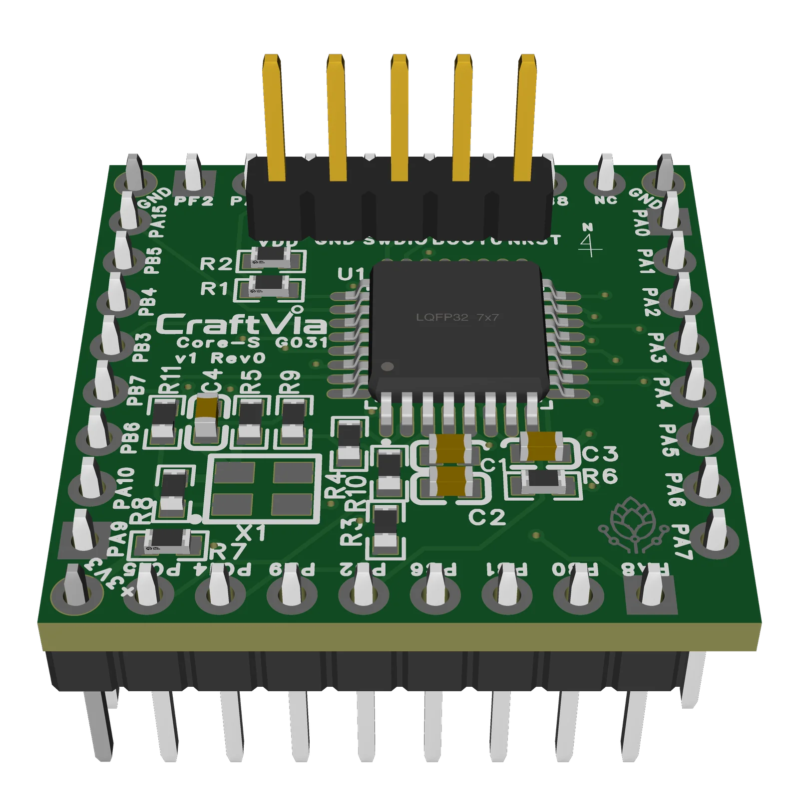

# CraftVia Core-S G031

> [!WARNING]
> **未検証のRev0ハードウェアです**  
> Rev0基板は発注済みで、現在は到着待ちです。未実装・未通電・未検証であり、製造・組立は自己責任となります。今後のRevisionで設計が変更される可能性があります。

[English](README.md) · [CraftVia](https://craftvia.org/ja/) · [Rev0リリースノート](RELEASE_NOTES.ja.md)



*Rev0 CADレンダリング — [表面](docs/images/core-s-g031-v1-rev0-front.webp) · [裏面](docs/images/core-s-g031-v1-rev0-back.webp)。画像は説明用であり、凍結済み設計SourceとGerber Packageを正とします。*

CraftVia Core-S G031は、CraftVia Core-Sインターフェースの最初の実装です。STM32G031K8T6とMCUの安定動作に必要な回路を小型Coreへまとめ、Station-S上で開発した後、Carrierや実機へ搭載することを想定しています。

デバッガ、USB、操作部、計測回路などの開発専用機能はCoreへ搭載せず、Station-S側へ分離します。

## 現在の状態

| 項目 | 状態 |
| --- | --- |
| 製品Version | v1 |
| PCB Revision | Rev0 |
| 基板製造 | 発注済み・到着待ち |
| 実装 | 未着手 |
| 通電 | 未実施 |
| 電気的検証 | 未実施 |
| Release tag | `v1-rev0`を予定 |

## Rev0概要

- MCU: STM32G031K8T6、LQFP32
- Core外形: 25.4 mm × 25.4 mm
- PCB: 4層
- Coreインターフェース: 4辺各8信号接点とKey付き電源接点
- 電源: 3.3 V
- デバッグ: SWD。PA14はSWCLKとBOOT0で共有
- 標準クロック: 内蔵HSI。外付け8 MHz発振器オプションはDNP
- CADソース: EasyEDA

共通の機械・電気要件は[CraftVia共通ドキュメント](https://github.com/craftvia/craftvia-docs)を正とします。製品固有のピン配置、実装オプション、制約、受入試験は、Rev0の[`仕様書`](docs/specification-v1-rev0.ja.md)と[`検証計画`](docs/verification-plan-v1-rev0.ja.md)を参照してください。

## Repo構成

```text
source/                      正本のEasyEDA編集可能ソース
fabrication/                 正本のGerberパッケージ
assembly/                    BOM、CPL、組立参考資料
docs/                        回路図PDFと製品ドキュメント
product.json                 Web参照用の機械可読製品Metadata
RELEASE_NOTES.md / RELEASE_NOTES.ja.md
                             Rev0の詳細と初品確認項目（英語正本／日本語翻訳）
SHA256SUMS.txt               整合性確認用manifest
```

## Rev0を使用する前に

基板発注・実装前に[`v1-rev0`のリリースノート](RELEASE_NOTES.ja.md)を必ず確認してください。

- Gerber ZIPだけがPCB製造の正本です。
- 出力済みCPLは未フィルタであり、BOMとの照合なしに実装サービスへ使用できません。
- ピンヘッダ寸法とStation-Sとの機械的スタックを実装前に確認する必要があります。
- 回路図PDFには過去のDraft表記が残っており、製造正本ではありません。
- [`SHA256SUMS.txt`](SHA256SUMS.txt)で全ファイルを照合してください。

## 初品検証

外観、電源短絡、電流制限付き通電、電源電圧・電流、SWD、BOOT動作、全Core接点の導通を確認します。検証後も`v1-rev0`タグは移動・置換せず、結果だけを追記します。設計変更が必要な場合は新しいRevisionを作成します。

## ライセンスとブランド

個別の表示がない限り、本リポジトリのハードウェア設計ファイルは[CERN-OHL-P-2.0](LICENSE)で提供します。区分と帰属表示については[CraftVia Licensing（英語正本）](LICENSES/README.md)および[参考訳](LICENSES/README.ja.md)を参照してください。

CraftViaの名称・ロゴはKohei Ikedaが所有し、ハードウェアライセンスの対象外です。[CraftVia Trademark Policy（英語正本）](LICENSES/TRADEMARK_POLICY.md)および[参考訳](LICENSES/TRADEMARK_POLICY.ja.md)を参照してください。改変品や第三者製造品を公式CraftVia製品として表示することはできません。
